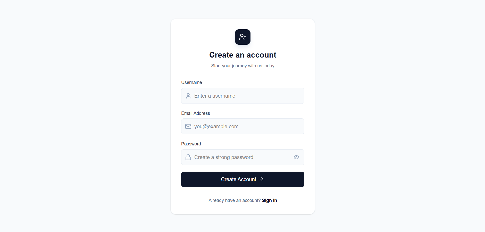
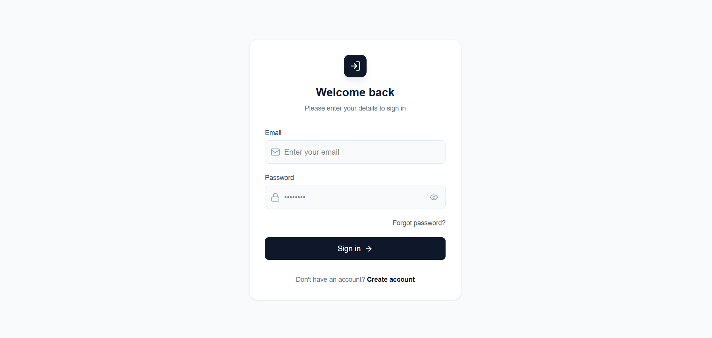
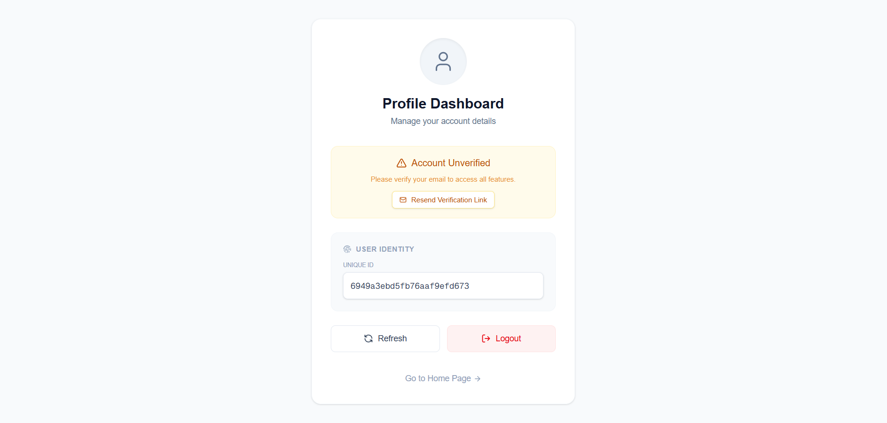
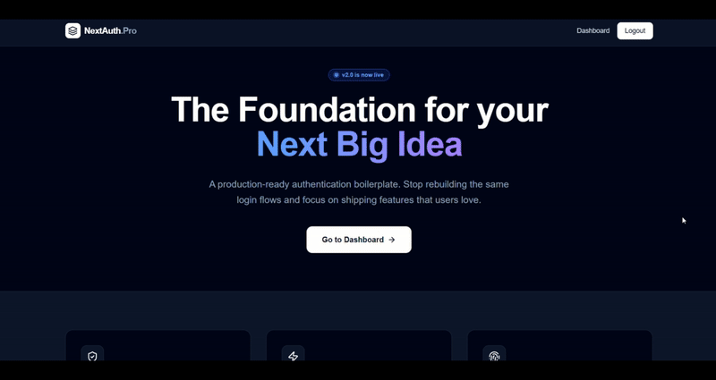
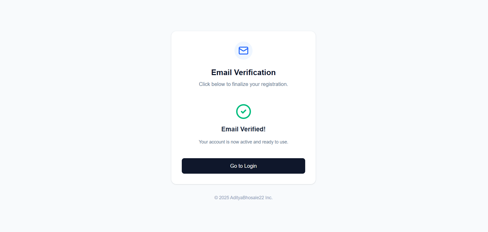

# 🔐 NextAuth.Pro

> **A production-ready authentication boilerplate built for the modern web.**

NextAuth.Pro is a robust, full-stack authentication system designed with security and developer experience in mind. It bridges the gap between complex security requirements and elegant UI design.

## ✨ Key Features

### 🛡️ Core Security

* **JWT Authentication:** Stateless authentication using JSON Web Tokens.
* **HTTP-Only Cookies:** Tokens are stored in secure, HTTP-only cookies to prevent XSS attacks.
* **Bcrypt Hashing:** Industry-standard password hashing before database storage.
* **Middleware Protection:** Edge-compatible middleware to guard private routes.

### 👤 User Experience

* **Full Auth Flow:** Sign up, Login, Logout, and Profile management.
* **Email Verification:** Token-based email verification system using SMTP.
* **Password Recovery:** Secure "Forgot Password" and "Reset Password" workflows.
* **Dark Mode:** Fully integrated light/dark theme toggle (System preference & Manual).

### 💻 Developer Experience

* **Type Safety:** End-to-end type safety with **TypeScript**.
* **Zod Validation:** Robust client-side and server-side schema validation.
* **Modern Stack:** Built on **Next.js 15 (App Router)** and **MongoDB**.

---

## 🛠️ Tech Stack

| Layer | Technology |
| --- | --- |
| **Framework** | Next.js 15 (App Router) |
| **Language** | TypeScript |
| **Styling** | Tailwind CSS + Lucide React |
| **Database** | MongoDB + Mongoose |
| **Auth** | JWT (jsonwebtoken) + Bcryptjs |
| **Email** | Nodemailer |
| **Validation** | Zod |

---

## 🚀 Getting Started

Follow these steps to get the project running locally.

### 1. Clone the repository

```bash
git clone https://github.com/AdityaBhosale22/nextjs-auth
cd nextjs-auth

```

### 2. Install Dependencies

```bash
npm install
# or
pnpm install

```

### 3. Environment Configuration

Create a `.env.local` file in the root directory.

> **Note:** Never commit your `.env.local` file to version control.

```env
# Database Connection
MONGODB_URI=mongodb+srv://<username>:<password>@cluster.mongodb.net/authDB

# Security
TOKEN_SECRET=your_super_secret_jwt_key_here
DOMAIN=http://localhost:3000

# Email Services (Nodemailer)
# For Gmail, you may need an 'App Password' if 2FA is enabled.
SMTP_HOST=smtp.gmail.com
SMTP_PORT=587
SMTP_USER=your_email@gmail.com
SMTP_PASS=your_app_specific_password

```

### 4. Run Development Server

```bash
npm run dev

```

Visit `http://localhost:3000` to view the application.

---

## 📁 Project Structure

```bash
src/
├── app/
│   ├── api/users/          # Backend API Endpoints
│   ├── login/              # Login Page
│   ├── signup/             # Registration Page
│   ├── profile/            # Protected Dashboard
│   ├── verifyemail/        # Token Verification Logic
│   └── resetpassword/      # Password Recovery Flow
├── components/             # Reusable UI Components
├── dbConfig/               # Database Connection Logic
├── helpers/                # Mailers and Token Extractors
├── models/                 # Mongoose Schemas (User)
└── middleware.ts           # Edge Middleware for Route Protection

```
## 📸 Screenshots

### Signup


### Login


### Profile Dashboard


### Home


### Email Verification


---

## 📡 API Reference

Here is an overview of the backend endpoints available in `src/app/api/users`:

| Method | Endpoint | Description | Access |
| --- | --- | --- | --- |
| `POST` | `/api/users/signup` | Register a new user and send verification email | Public |
| `POST` | `/api/users/login` | Authenticate user and set HTTP-only cookie | Public |
| `GET` | `/api/users/logout` | Clear auth cookie and terminate session | Private |
| `GET` | `/api/users/me` | Fetch current user details (ID, Email, Verification Status) | Private |
| `POST` | `/api/users/verifyemail` | Verify user account using token | Public |
| `POST` | `/api/users/forgotpassword` | Initiate password reset email flow | Public |

---

## 🤝 Contributing

Contributions are welcome! Please feel free to submit a Pull Request.

1. Fork the Project
2. Create your Feature Branch (`git checkout -b feature/AmazingFeature`)
3. Commit your Changes (`git commit -m 'Add some AmazingFeature'`)
4. Push to the Branch (`git push origin feature/AmazingFeature`)
5. Open a Pull Request

## 📄 License

Distributed under the MIT License. See `LICENSE` for more information.

---

<p align="center">
Built with ❤️ using Next.js 15
</p>